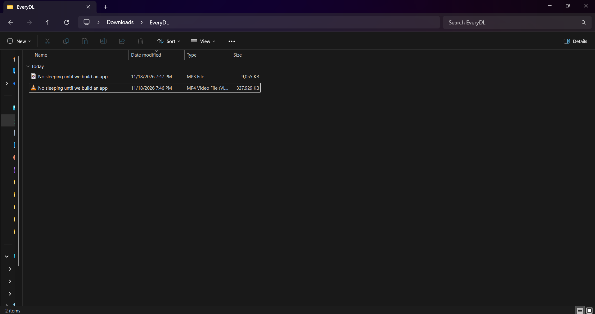
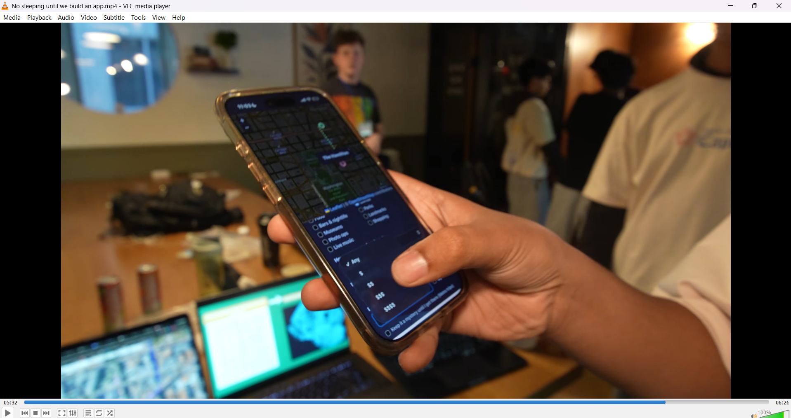
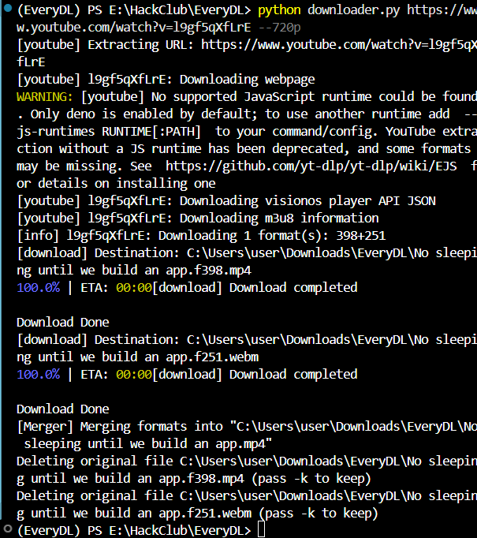
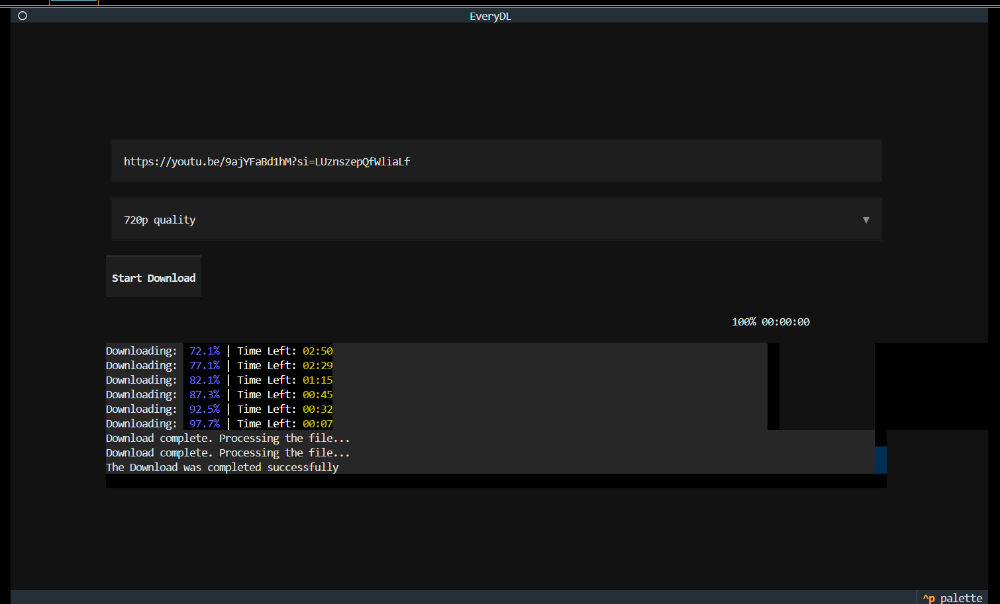
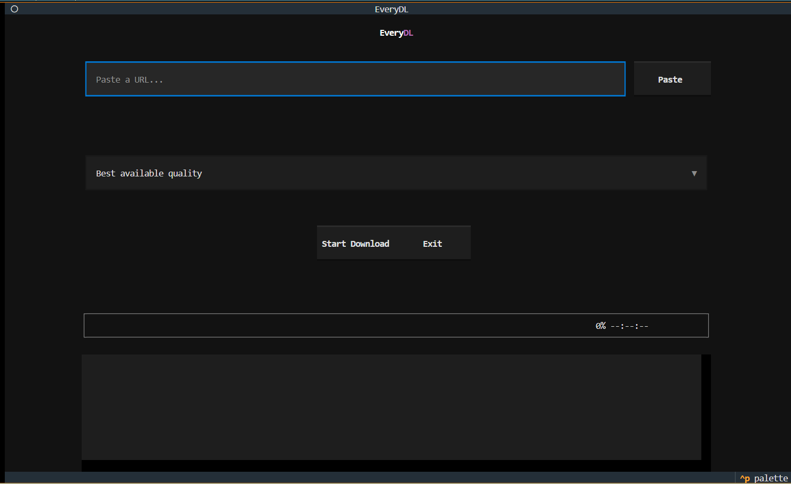
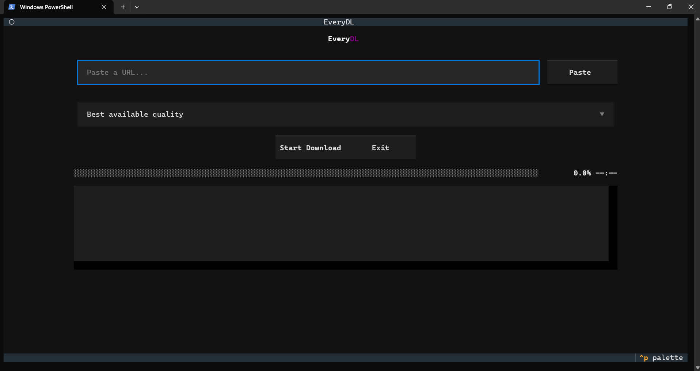

# EveryDL JOURNAL


## Day 1

- I got the idea and gave the base idea to my opencode agent to form a spec and for me to understad a build path etc.

- I wrote the first part - which is downloader.py and it is baisically just an engine for the app that i tested as a cli tool, very simple and minimal. I ran into some venv issues, fixed them and and got the 2 main feartures - youtube video and youtuibe audio downloading to work. here are screenshots:





- Now I tested it on other sites (instagram and spotify), got an error with spotify because of some DRM extractor, I asked my agent about it and I fixed it. Screenshots of instagram and Spotify downloads working:


- The last thing to do is to test wether the --720p flag works, did that, here are screenshots:




## Day 2

- Started in the evening after school and first I started to think about the TUI. I havent made a TUI in Textual before, so i decided to ask my agent for help to learn. It gave me a plan, I accepted and gave me an example code with a part by part explanation. I spent some time learning the explanation then typed the code - changing a lot of things by hand and also changed the code structure for some parts to match what I am comfortable with, Then asked agent if it was ok.

- The agent found 3 main problems - all small ones like typos or syntax errors - I told it to just fix it.

- I ran it, some errors came, asked agent about it, it was just a threading bug - fixed it.

- I am going to stop for today, so status is - the baisic TUI is complete its not beautifull or nything, and its not perfect, i will make a lot of changes. another problem is if i try to download a playlist, it only downlaods first one on that. need to fix that also tomorrow. Screenshot of current TUI:




## Day 3

- In the morning, Iasked the agent for plans for a paste button, exit button and a hero on the top, after looking at it, I managed to almost do the exit and paste on my own, i have use pyperclip before and the exit button was not too bad, the only problem i faced was to liek gracefully stop any downloads if there, had to follow a tutorial for that. I asked agent is it ok, it found 3 errors mainly, small ones, told \it to fix them, tahst done

- Now I tested it, the bottons work. then i made the hero, but coudnt figure out how to increase the size or anything, agent told not possible. earlier i had looked into trying to put images but that also wouldnt work - so keep it for now i guess. Screenshot of currrnt TUI:



- Evening i resumed working on this. first I did some small distribution fixes which my agent recomended me to do - I made it so that in my computer, if i run ```uv tool install -e``` . then i can run ```everydl``` command everywhere to open the app, just kind of preperation for the exe final version. Then there was a series of errors regarding the progress bar, spend a long time triying stuff on my iown, then decided to ask agent. agent suggested to use a classic static progress bar instead of the textual one. did that it works. then i spent some time working on resizing the bar and like spacing etc.

- Then I added an eta display to the tui progress bar also. Then worked on the pyinstaller setup and ffmpeg bundling to get a single clean exe. got some problems, all resolved. Then i noticed from earlier, that the tui looked broken at some like sizes of terminal and if i am not in fullscreen, so i asked my agnet to fix that then understood what it did. Screenshot of UI now:




## Day 4

- Today i started working on adding playlist support. my plan was to have 3 modes to download latest item in a playlist or all or customs selection. Implemented that, then there was a series of problems. this part i vibecoded through it a lot since these were like classic/simple errors. this didnt turn out that well because my agent randomly changed spotify system from using yt dlp to using a spotify api which i couldnt get for free. reverted it when i found out and then continued

- After that, later, another issue came up which was the progressbar size was going randomly wierd when resizing window. fixed it with agent. then during that fix, the eta stopped showing, fixed that too.

- Now I started working manually on control buttons - Pause/Resume, Stop, Skip(skips the current item from a playlist). told agent to evalute. it found 2 big bugs - it fixed both. then i told agent to alos make the progress bar and other stast clear when i click stop download.