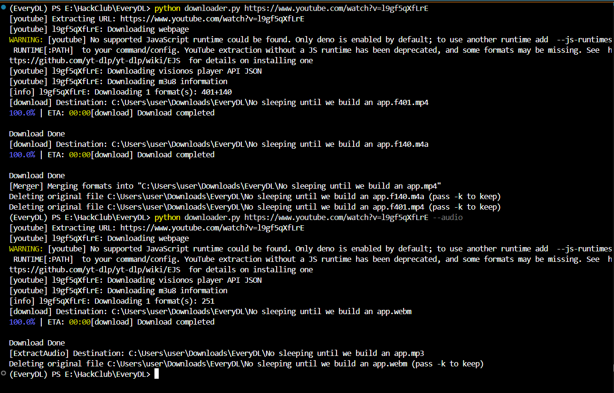
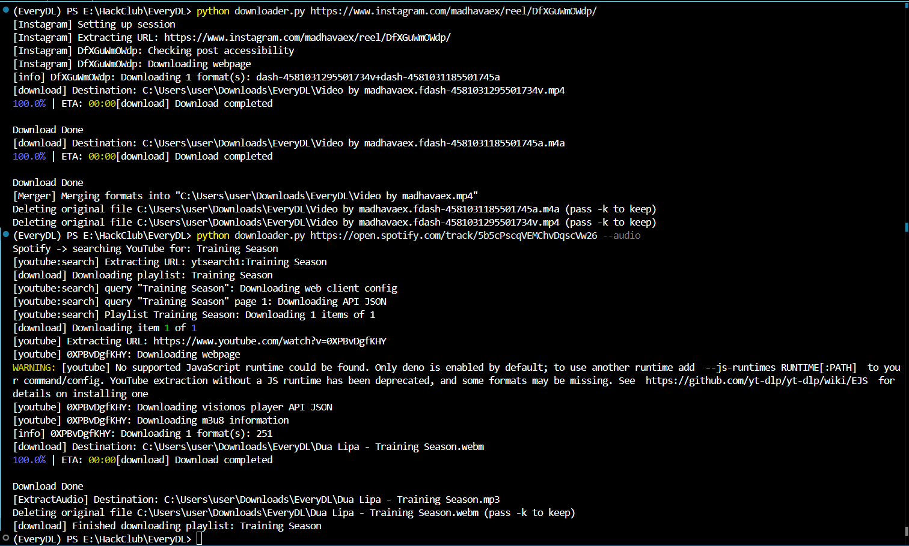
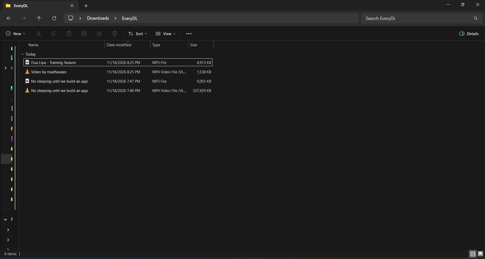
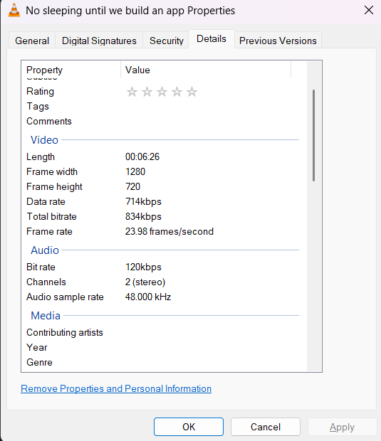

# EveryDL JOURNAL

## Day 1

- I got the idea and gave the base idea to my opencode agent to form a spec and for me to understad a build path etc.

- I wrote the first part - which is downloader.py and it is baisically just an engine for the app that i tested as a cli tool, very simple and minimal. I ran into some venv issues, fixed them and and got the 2 main feartures - youtube video and youtuibe audio downloading to work. here are screenshots:

- Now I tested it on other sites (instagram and spotify), got an error with spotify because of some DRM extractor, I asked my agent about it and I fixed it. Screenshots of instagram and Spotify downloads working:

- The last thing to do is to test wether the --720p flag works, did that, here are screenshots:

